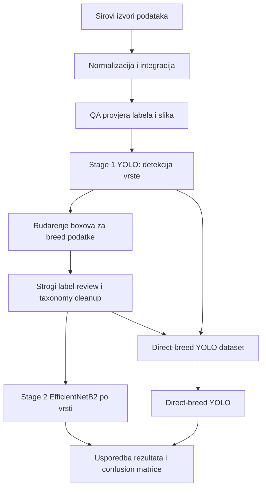

# Prezentacijska skripta: sustav za prepoznavanje životinjskih vrsta i pasmina

Datum pripreme: 2026-07-06

Projekt: `strojno-ucenje`

Aktualni eksperimentalni run: `qa_full_20260706_b12w12_yolo40`

## 1. Kratki uvod za prezentaciju

Ovaj projekt razvija računalno-vidni sustav koji iz slike životinje pokušava prepoznati prvo vrstu životinje, a zatim, gdje je to smisleno, i pasminu, podvrstu, morf ili drugu vizualno korisnu finiju kategoriju.

Nije cilj samo trenirati jedan model na sirovim folderima slika. Cilj je napraviti ponovljiv ML pipeline s kontrolom kvalitete podataka, provjerom labela, korištenjem označenih bounding boxova, rudarenjem dodatnih boxova iz ne-YOLO izvora i usporedbom dvaju pristupa:

1. Dvostupanjski pristup: YOLO prvo detektira vrstu, zatim EfficientNetB2 klasificira pasminu unutar te vrste.
2. Jednostupanjski pristup: jedan YOLO model odmah detektira najprecizniju dostupnu klasu, npr. pasminu, podvrstu ili vrstu ako nema valjane finije klase.

Glavna ideja je da se problem ne tretira kao obično sortiranje slika po folderima, nego kao hijerarhijski problem s vrlo neujednačenim i šumnim podacima iz više izvora.

## 2. Problem koji projekt rješava

U stvarnim datasetovima za životinje postoje tri velika problema.

Prvo, oznake nisu ujednačene. Ista pasmina može biti zapisana različito, npr. s razmakom, crticom, velikim/malim slovima ili kao sinonim.

Drugo, neke životinje uopće nemaju prave pasmine. Za takve vrste nema smisla izmišljati lažne "breed" klase. Ako postoji vizualno razlikovna podvrsta ili morf, ona se može koristiti, ali ako ne postoji, model treba ostati na razini vrste.

Treće, dio podataka ima bounding boxove, a dio ima samo labelu slike. Za model detekcije trebaju boxovi, pa se za ne-YOLO slike koristi Stage 1 detektor za generiranje boxova, ali samo kad se predikcija vrste slaže s poznatom labelom slike.

## 3. Arhitektura sustava

Za prezentaciju bih ovo objasnio ovako:

"Pipeline prvo standardizira podatke i provjerava jesu li slike, labeli i metadata međusobno konzistentni. Nakon toga YOLO model u Stage 1 uči detektirati vrstu životinje. Taj model se zatim koristi kao alat za rudarenje dodatnih bounding boxova na slikama koje imaju pasminsku labelu, ali nemaju ručno označen box. Nakon toga treniraju se dva breed-level pristupa: dvostupanjski EfficientNetB2 i jednostupanjski YOLO koji direktno predviđa finu klasu."

## 4. Što je napravljeno na podacima

U projekt su integrirani i uređeni razni YOLO i non-YOLO izvori, uključujući ručno označene setove, Wikimedia slike, Oxford-IIIT Pet podatke, datasetove za patke, guske, krave, konje, deve, kuniće i druge životinje.

Posebna pažnja je bila na tome da se ne izgubi semantika labela:

- YOLO label za Stage 1 ostaje vrsta životinje, npr. `cat`, `dog`, `cattle`, `duck`.
- Pasmina ili podvrsta se čuva u metadata zapisima i kasnije koristi za Stage 2 i direct-breed YOLO.
- Ako CSV iz izvora sadrži stvarna imena klasa, CSV se koristi kao izvor istine za mapiranje numeričkih YOLO class id-jeva.
- `unknown`, `unlabeled`, `other`, generičke vrste korištene kao fake breed i očiti source artifacti se izbacuju iz Stage 2 breed klasa.
- Ako vrsta nema barem dvije stvarne vizualno korisne finije klase, za nju se ne trenira Stage 2 submodel.
- U direct-breed YOLO modelu takva vrsta ipak ostaje kao fallback species label.

Ovo je bitno jer pogrešno spajanje labela može model naučiti krivu biologiju. Na primjer, ako se `cat` koristi kao "breed" label, model ne uči pasminu mačke nego samo ponavlja vrstu. Takve oznake se zato uklanjaju iz Stage 2.

## 5. Label hygiene i taksonomska pravila

Projekt ne koristi slijepo sve foldere kao klase. Napravljen je strogi audit labela.

Labela se može klasificirati kao:

- species label
- formal breed
- subspecies
- species-within-group
- morph ili color form
- synonym ili spelling variant
- generic placeholder
- unknown/unlabeled
- invalid artifact
- uncertain/manual-review

Praktično pravilo je:

"Model smije učiti samo klase koje su vizualno i biološki smislene."

Primjeri:

- Paunovi se u Stage 1 mogu tretirati kao `peafowl`, ali u breed/direct dijelu se mogu koristiti indijski paun, zeleni paun, kongoanski paun ili vizualno jasni morfovi ako labeli to podržavaju.
- Patke i guske mogu imati različite biološke linije i domaće pasmine; to se ne smije spljoštiti u jednu pogrešnu klasu.
- Alpaka nema klasične pasmine kao pas ili mačka; ako nema stabilnih vizualnih finih klasa, ostaje species fallback.

## 6. Stage 1: YOLO detektor vrste

Stage 1 je prvi i najvažniji dio dvostupanjskog sustava. On mora na slici pronaći životinju i odrediti kojoj vrsti pripada.

Aktualni Stage 1 run koristi:

- model: YOLO11s
- GPU runtime: AMD ROCm
- GPU: AMD Radeon RX 7800 XT
- uređaj u PyTorch/Ultralytics logovima: `CUDA:0`, ali to je ROCm mapping za AMD karticu
- run: `hybrid_shared_fresh_qa_full_20260706_b12w12_yolo40`
- broj epoha: 40
- batch/workers u nazivu runa: `b12w12`

Dataset za Stage 1 u aktualnom runu:

- YOLO source datasetovi: 36
- ukupno slika u raw YOLO izvorima prema QA: 69,643
- ukupno label datoteka prema QA: 47,340
- ukupno metadata zapisa prema QA: 14,279
- train records u hibridnom specu: 32,398
- validation records: 4,532
- test records: 2,685
- trenirane Stage 1 klase: 19

Stage 1 klase:

`alpaca`, `bactrian_camel`, `cat`, `cattle`, `chicken`, `dog`, `donkey`, `dromedary`, `duck`, `goat`, `goose`, `horse`, `llama`, `peafowl`, `pig`, `pigeon`, `rabbit`, `sheep`, `turkey`

Vrste izbačene iz ovog Stage 1 speca zbog nedostatka čistih train slika:

- `camel`
- `water_buffalo`

To ne znači da su ti podaci nužno obrisani, nego da nisu zadovoljili uvjet za čistu species-level train klasu u tom konkretnom Stage 1 snapshotu.

### Stage 1 rezultati aktualnog runa

Najbolji checkpoint po mAP50:

- epoha: 32
- precision: 0.78775
- recall: 0.75508
- mAP50: 0.78101
- mAP50-95: 0.47654

Zadnja epoha:

- epoha: 40
- precision: 0.80606
- recall: 0.74408
- mAP50: 0.77080
- mAP50-95: 0.47306

Za prezentaciju:

"Najbolji model nije nužno zadnja epoha. U ovom runu najbolji mAP50 je u epohi 32, dok zadnja epoha ima nešto veći precision, ali niži mAP50. Zato downstream mining koristi najbolji checkpoint, ne zadnji."

## 7. Confusion matrix za Stage 1

Nakon Stage 1 treninga generirana je species confusion matrix. Ona služi za provjeru koje se vrste međusobno najčešće miješaju.

Aktualna evaluacija:

- validation records: 4,532
- confusion labels uključuju 19 životinjskih klasa plus `__background__`
- object recall proxy: 0.94266
- object precision proxy: 0.56490

Važno objašnjenje:

"Recall proxy je visok, što znači da model uglavnom pronalazi objekte, ali precision proxy pokazuje da postoji još dosta false positive ili background zabuna. Zato se confusion matrix i breed mining koriste oprezno, s dodatnim filtriranjem."

Za pokazati na prezentaciji:

- `results/reports/full_breed_pipeline/qa_full_20260706_b12w12_yolo40/stage1_species_eval/species_confusion_matrix_counts.png`
- `results/reports/full_breed_pipeline/qa_full_20260706_b12w12_yolo40/stage1_species_eval/species_confusion_matrix_normalized.png`
- `results/reports/full_breed_pipeline/qa_full_20260706_b12w12_yolo40/stage1_species_eval/species_confusion_pairs.csv`

## 8. Hibridni Stage 1 dataset

Stage 1 ne koristi samo jednu vrstu podataka. U train planu postoje:

- stvarni primjeri: 6,476 planova
- sintetički složeni primjeri: 6,476 planova
- augmentirani single-object primjeri: 3,238 planova

Ukupno train planova: 16,190

Ukupno train recorda: 32,398

Objašnjenje za prezentaciju:

"Hibridni dataset kombinira realne slike i kontrolirane augmentacije. Time se pokušava povećati robusnost modela, pogotovo kad su neke vrste slabije zastupljene ili kad se životinje pojavljuju u različitim kontekstima."

## 9. Rudarenje / pseudo-labeling za breed-level dataset

Nakon Stage 1 treninga, najbolji Stage 1 checkpoint se koristi za generiranje bounding boxova na slikama koje imaju poznatu breed/subspecies labelu, ali nisu originalno YOLO dataset.

Pravilo je konzervativno:

1. Slika ima poznatu labelu vrste i finiju labelu.
2. Stage 1 model detektira životinju.
3. Predviđena vrsta se mora slagati s poznatom vrstom slike.
4. Tek tada se box prihvaća kao kandidat za breed-level trening.
5. Originalni dataset se ne prepisuje; generirani boxovi idu u novi privremeni manifest.

Ovo smanjuje rizik da Stage 2 nauči pogrešne cropove, npr. pozadinu ili životinju druge vrste.

Za prezentaciju:

"Mining nije automatsko vjerovanje modelu. To je kontrolirano pseudo-labeliranje s uvjetom slaganja vrste i kasnijim label QA filtrom."

## 10. Stage 2: EfficientNetB2 breed/subspecies klasifikatori

Stage 2 ne trenira jedan ogroman classifier za sve pasmine svih životinja. Umjesto toga koristi species-conditioned pristup.

To znači:

1. Stage 1 prvo kaže koja je vrsta i daje bounding box.
2. Slika se cropa na životinju.
3. Za tu vrstu se koristi odgovarajući EfficientNetB2 classifier.
4. Taj classifier predviđa samo klase koje imaju smisla unutar te vrste.

Prednost:

- Mačje pasmine se ne uspoređuju s pasminama kokoši.
- Model ne troši kapacitet na nemoguće klase.
- Manji classifier po vrsti lakše uči fine razlike.
- Lakše je izbaciti vrste koje nemaju stvarnu finu podjelu.

U aktualnom nastavku runa Stage 2 je podešen na 5 epoha za breed-level trening. Ako postoji stari kompatibilni breed checkpoint za neku vrstu, koristi se kao baseline/warm-start. Kod promjene broja klasa učitavaju se samo kompatibilni tenzori, a novi classifier head se trenira za trenutnu taksonomiju.

Za prezentaciju:

"Stage 2 koristi staro znanje gdje je kompatibilno, ali ne forsira stare glave modela ako se promijenio broj klasa. Time se dobije brži start bez lomljenja nove taksonomije."

## 11. Direct-breed YOLO model

Drugi pristup je direct-breed YOLO. On pokušava u jednom koraku detektirati životinju i predvidjeti najprecizniju korisnu labelu.

Klasa u direct-breed YOLO nije uvijek formalna pasmina. Može biti:

- pasmina, ako postoji
- podvrsta, ako je vizualno smislena
- species-within-group, ako Stage 1 grupa sadrži više bioloških vrsta
- morph/color form, ako je stabilan i vizualno prepoznatljiv
- fallback species label, ako nema valjane finije klase

U aktualnom nastavku direct-breed YOLO je podešen na 5 epoha. Kao baza se koristi najnoviji prethodni direct-breed YOLO checkpoint ako postoji; ako ne postoji, fallback je najbolji Stage 1 species checkpoint.

Za prezentaciju:

"Direct-breed YOLO je jednostavniji za inference jer odmah daje jednu detekciju s finom klasom. Mana je što mora učiti mnogo više klasa odjednom, pa može biti osjetljiviji na class imbalance i šum u labelima."

## 12. Zašto se treniraju oba pristupa

Treniraju se oba pristupa jer imaju različite prednosti.

Dvostupanjski pristup:

- bolji za hijerarhijske podatke
- prirodno odvaja species detection i breed classification
- lakše kontrolira biologiju i label hijerarhiju
- može imati bolju interpretabilnost

Direct-breed YOLO:

- jednostavniji inference
- jedan model umjesto detektor plus više classifiera
- direktno daje bounding box i finu klasu
- može biti praktičniji za aplikaciju ako metrika bude dovoljno dobra

Usporedba se radi preko:

- mAP
- precision
- recall
- F1 po klasama
- confusion matrix
- pogreške po vrstama i pasminama
- ponašanje na rijetkim klasama

## 13. QA i pouzdanost pipelinea

Projekt ima više QA točaka.

Prije Stage 1:

- provjera GPU-a
- provjera source datasetova
- provjera broja slika, labela i metadata zapisa
- provjera PHR dataset taxonomy
- dataloader stress test s realnim batch/workers postavkama

Nakon Stage 1:

- provjera da checkpoint postoji
- provjera da hybrid spec postoji
- provjera da se species confusion matrix može izvesti
- provjera da downstream mining koristi stvarni Stage 1 best checkpoint

Prije Stage 2:

- build privremenog breed manifesta
- strict label review
- uklanjanje unknown/generic/noisy labela
- trainable taxonomy samo s valjanim finim klasama
- provjera da image pathovi postoje
- corrupt/unreadable slike se ne smiju rušiti cijeli run

Prije direct YOLO:

- priprema RGB-safe YOLO exporta
- provjera `data.yaml`
- provjera da su class id-jevi valjani
- provjera da fallback species klase ostaju tamo gdje nema breed split-a

## 14. Tehnički problemi koji su riješeni

Tijekom razvoja riješeno je više stvarnih problema koji su mogli srušiti trening ili pokvariti podatke.

Riješeni problemi:

- neujednačena imena pasmina i foldera
- numeričke i besmislene klase iz CSV/YOLO izvora
- slike u formatima koji ruše multiprocessing dataloader
- koruptirane JPEG slike koje izbacuju warninge
- krivi EXIF/TIFF headeri
- stari PHR merge koji bi mogao obrisati nove integracije
- duplicirani YOLO source folderi već integrirani u PHR
- preveliki sintetički canvas u dataloaderu
- prazni target batch u YOLO loss funkciji
- misleading `tqdm` logovi u Stage 2
- razlika između `CUDA:0` oznake i stvarne AMD ROCm kartice

Za prezentaciju:

"Velik dio projekta nije samo treniranje modela, nego izgradnja pouzdanog podatkovnog i trening pipelinea. Bez toga bi rezultati bili neponovljivi i vrlo lako bi se treniralo na krivim labelima."

## 15. Artefakti koje mogu pokazati

Glavni Stage 1 rezultati:

- `runs/detect/artifacts/hybrid_shared_detector/hybrid_shared_fresh_qa_full_20260706_b12w12_yolo40/results.csv`
- `runs/detect/artifacts/hybrid_shared_detector/hybrid_shared_fresh_qa_full_20260706_b12w12_yolo40/weights/best.pt`
- `runs/detect/artifacts/hybrid_shared_detector/hybrid_shared_fresh_qa_full_20260706_b12w12_yolo40/weights/last.pt`

QA i evaluacija:

- `results/reports/full_breed_pipeline/qa_full_20260706_b12w12_yolo40/qa_pre_stage1_report.json`
- `results/reports/full_breed_pipeline/qa_full_20260706_b12w12_yolo40/qa_post_stage1_for_mining_report.json`
- `results/reports/full_breed_pipeline/qa_full_20260706_b12w12_yolo40/stage1_species_eval/species_confusion_matrix_counts.png`
- `results/reports/full_breed_pipeline/qa_full_20260706_b12w12_yolo40/stage1_species_eval/species_confusion_matrix_normalized.png`

Dataset spec:

- `data/processed/species_aware/hybrid_shared_qa_full_20260706_b12w12_yolo40/hybrid_dataset_spec.json`

Breed build i downstream:

- `results/reports/full_breed_pipeline/qa_full_20260706_b12w12_yolo40/03_breed_build.log`
- `data/processed/breed_runs/temporary_breed_run_retrain_qa_full_20260706_b12w12_yolo40/`

## 16. Predloženi govor po slajdovima

### Slajd 1: Naslov

"Tema projekta je prepoznavanje životinjskih vrsta i pasmina iz slika. Umjesto jednog jednostavnog classifiera, napravljen je pipeline koji kombinira detekciju objekata, hijerarhijsku klasifikaciju, pseudo-labeling i strogu kontrolu kvalitete labela."

### Slajd 2: Motivacija

"Problem je težak jer podaci dolaze iz različitih izvora. Neki imaju bounding boxove, neki samo imena pasmina, neka imena su sinonimi ili pogrešno napisana, a neke životinje uopće nemaju prave pasmine. Zato je važan podatkovni pipeline, ne samo model."

### Slajd 3: Podaci

"U aktualnom Stage 1 runu koristi se 36 YOLO source datasetova, s približno 69 tisuća slika u raw YOLO izvorima. Nakon filtriranja i izgradnje hibridnog speca, Stage 1 koristi 32,398 train recorda, 4,532 validation recorda i 2,685 test recorda."

### Slajd 4: Label hygiene

"Prije treninga se provjerava što labela stvarno znači. Ako je labela prava pasmina, može ući u breed trening. Ako je podvrsta ili morf i vizualno je smislen, može se koristiti kao fina klasa. Ako je unknown, placeholder ili samo generička vrsta korištena kao pasmina, izbacuje se iz Stage 2."

### Slajd 5: Stage 1 YOLO

"Stage 1 je YOLO11s detektor koji prepoznaje vrstu životinje. U aktualnom runu trenira 19 vrsta. Najbolji checkpoint je iz epohe 32, s mAP50 0.78101 i mAP50-95 0.47654. Taj najbolji checkpoint se koristi za kasnije rudarenje boxova."

### Slajd 6: Mining

"Nakon Stage 1, model se koristi za generiranje bounding boxova na slikama koje imaju poznatu pasminu, ali nemaju box. Box se prihvaća samo ako se predviđena vrsta slaže s labelom slike. Time se smanjuje rizik da Stage 2 dobije pogrešne cropove."

### Slajd 7: Stage 2 EfficientNetB2

"Dvostupanjski pristup koristi EfficientNetB2 modele po vrsti. Ako Stage 1 kaže da je objekt mačka, tada se koristi classifier za mačje pasmine. Ako kaže da je kokoš, koristi se classifier za kokoši. Tako se model ne mora istovremeno odlučivati između svih pasmina svih životinja."

### Slajd 8: Direct-breed YOLO

"Paralelno se trenira direct-breed YOLO model. On pokušava direktno detektirati najprecizniju labelu. To može biti pasmina, podvrsta, morf ili fallback species label. Ovaj pristup je jednostavniji za inference, ali teži za treniranje jer ima širi i nebalansiraniji class space."

### Slajd 9: Evaluacija

"Evaluacija uključuje standardne metrike detekcije poput precision, recall, mAP50 i mAP50-95, ali i confusion matrix. Confusion matrix je posebno važna jer pokazuje koje se vrste ili pasmine najviše miješaju."

### Slajd 10: Zaključak

"Glavni doprinos projekta je izgradnja cijelog ML pipelinea: od integracije i čišćenja podataka, preko species detekcije, do breed-level modela i evaluacije. Projekt pokazuje da je kod ovakvih stvarnih datasetova kvaliteta labela i kontrola pipelinea jednako važna kao i izbor arhitekture modela."

## 17. Pitanja koja mogu doći i kratki odgovori

Pitanje: Zašto ne trenirati samo jedan model?

Odgovor: Jedan model je jednostavniji, ali mora učiti sve vrste i sve pasmine odjednom. Dvostupanjski model bolje koristi hijerarhiju: prvo vrsta, zatim fina klasa unutar vrste.

Pitanje: Zašto neke vrste nemaju Stage 2 model?

Odgovor: Zato što nema smisla trenirati breed classifier ako vrsta nema barem dvije stvarne i vizualno smislene finije klase. U tom slučaju direct YOLO koristi species fallback.

Pitanje: Kako se sprječava da pseudo-labeling unese šum?

Odgovor: Box se prihvaća samo ako Stage 1 predikcija vrste odgovara poznatoj labeli slike, zatim prolazi kroz strict label review i taxonomy cleanup.

Pitanje: Zašto je `CUDA:0` ako je GPU AMD?

Odgovor: PyTorch ROCm backend često izlaže AMD GPU kroz CUDA-kompatibilni API naziv. Logovi potvrđuju da je stvarni uređaj AMD Radeon RX 7800 XT.

Pitanje: Što znači da je najbolji model iz epohe 32, a trening je išao do 40?

Odgovor: Tijekom treninga se sprema checkpoint s najboljom validacijskom metrikom. Zadnja epoha nije uvijek najbolja jer model može početi overfitati ili se metrika može malo pogoršati.

Pitanje: Što je najveći rizik u projektu?

Odgovor: Najveći rizik je kvaliteta i konzistentnost labela. Kod životinjskih pasmina pogrešna taksonomija može model naučiti pogrešne klase, zato je label QA centralni dio pipelinea.

## 18. Što ažurirati nakon završetka downstream treninga

Kad završi trenutni nastavak runa, dopuniti ovu skriptu sa:

- finalnim Stage 2 EfficientNetB2 metrikama
- per-species breed confusion matricama
- globalnom Stage 2 breed confusion matricom
- direct-breed YOLO `results.csv` metrikama
- direct-breed YOLO confusion matricom ako je generirana
- usporedbom dvostupanjskog i direct pristupa

Mjesta gdje će se to najvjerojatnije nalaziti:

- `artifacts/two-stage-breed-models-*/metrics/two_stage_breed_models_summary.csv`
- `results/reports/full_breed_pipeline/qa_full_20260706_b12w12_yolo40/stage2_confusions/`
- `runs/detect/artifacts/.../yolo11_breed_retrain_qa_full_20260706_b12w12_yolo40_resume/`

## 19. Jednominutna verzija ako prezentacija mora biti kratka

"Projekt radi sustav za prepoznavanje životinjskih vrsta i pasmina iz slika. Podaci dolaze iz mnogo različitih izvora, pa je prvo napravljena integracija, čišćenje labela i QA provjera. Stage 1 je YOLO11s model koji detektira vrstu životinje. Najbolji aktualni Stage 1 checkpoint ima mAP50 0.78101 na validaciji. Taj model se zatim koristi za rudarenje bounding boxova na slikama koje imaju breed labelu, ali nemaju ručno označen box. Nakon toga se treniraju dva breed-level pristupa: EfficientNetB2 classifier po vrsti i direct-breed YOLO koji odmah predviđa najprecizniju klasu. Cijeli pipeline je napravljen tako da ne koristi unknown i fake breed labele, nego samo biološki i vizualno smislene klase."

